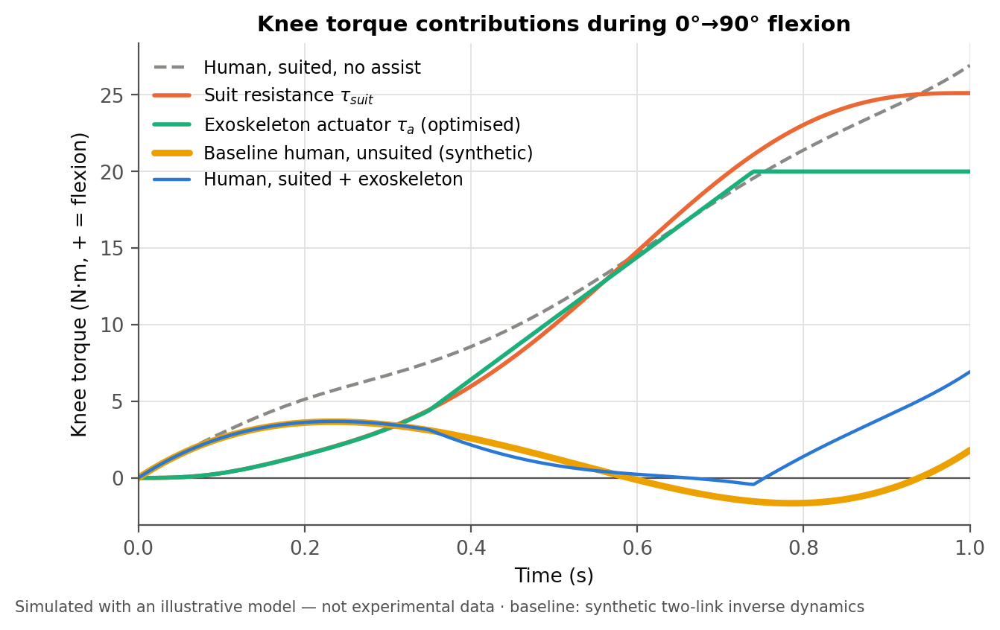
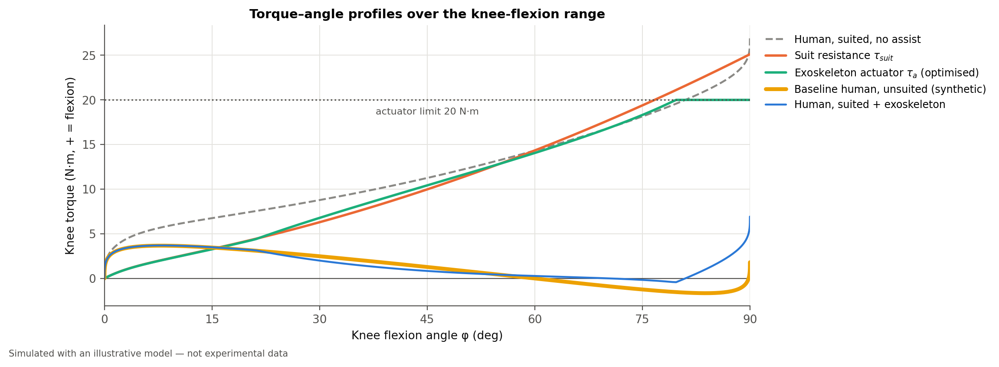
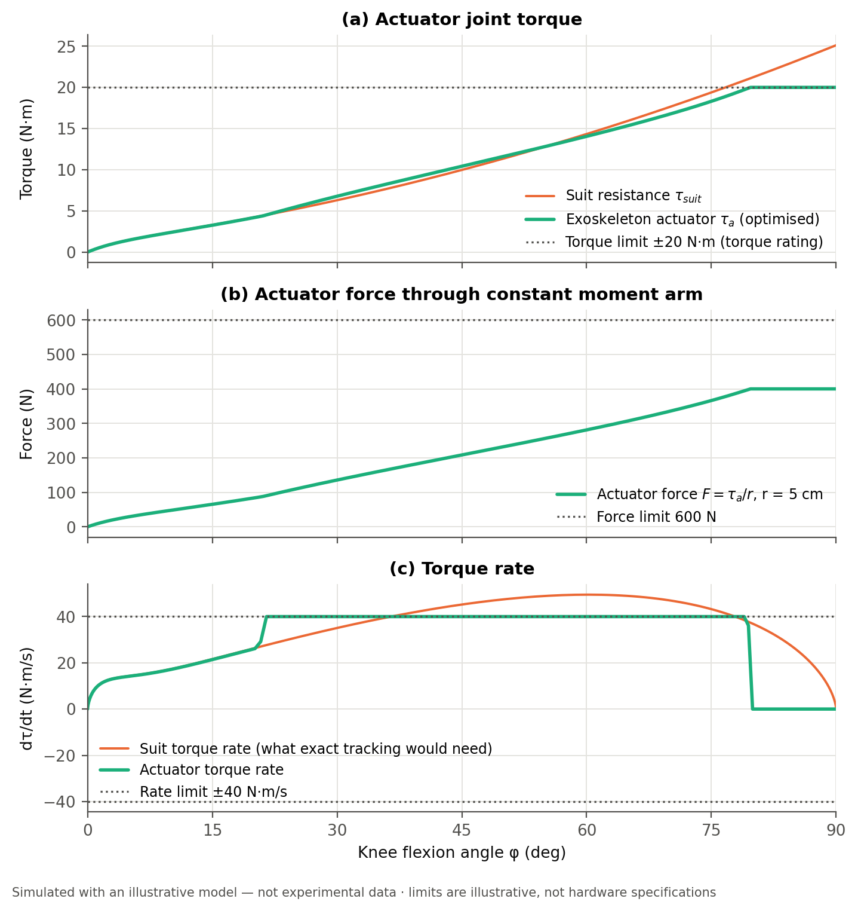
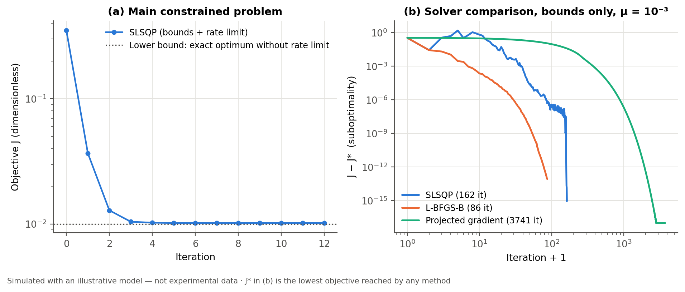
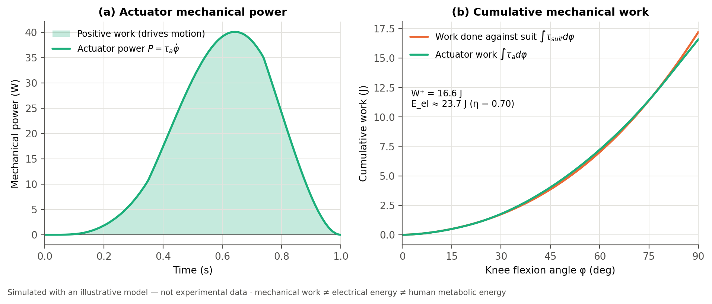
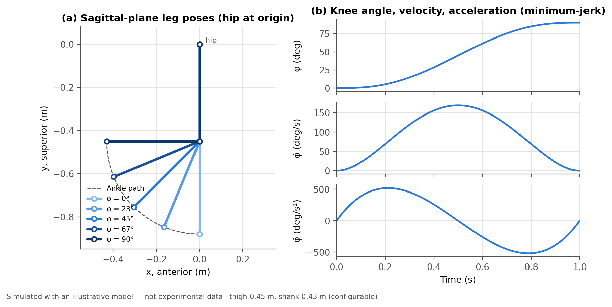
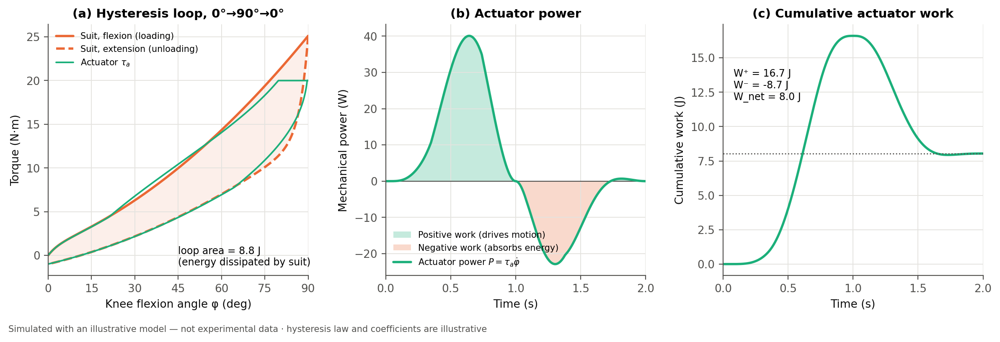
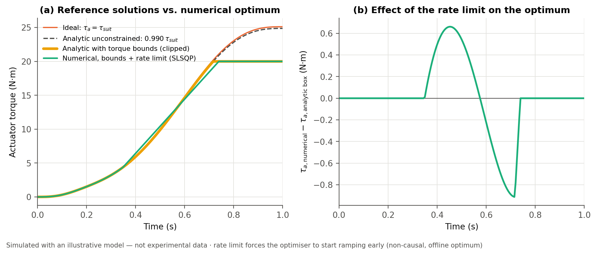
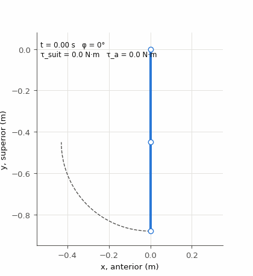

# Bioastronautics Exosuit: Optimising Active Knee Assistance Against EVA Spacesuit Resistance

A Python simulation of a human leg moving inside a simplified pressurised spacesuit while an
active exoskeleton supplies assistive knee torque. It includes planar two-link leg kinematics,
a nonlinear and hysteretic suit-resistance model, constrained optimisation of the actuator
torque profile, mechanical-work and energy accounting, automatically generated figures, a
sensitivity study, and a pytest suite.

> [!IMPORTANT]
> **Every number in this repository is simulated.** The suit-resistance law, its coefficients,
> and the actuator limits are illustrative. They are not fitted to measured suit data and are
> not hardware or flight specifications. The baseline human torque is a physics-based synthetic
> reference computed by rigid-body inverse dynamics, not measured joint-torque data. The model
> reports reductions in **modelled additional knee torque**. It makes **no claim** about
> astronaut metabolic expenditure.

---

## Contents

1. [Scientific motivation](#1-scientific-motivation)
2. [Research question](#2-research-question)
3. [Key corrections to the original formulation](#3-key-corrections-to-the-original-formulation)
4. [Mathematical model](#4-mathematical-model)
5. [Optimisation algorithm](#5-optimisation-algorithm)
6. [Results](#6-results)
7. [Sensitivity analysis](#7-sensitivity-analysis)
8. [Assumptions and limitations](#8-assumptions-and-limitations)
9. [Installation and quick start](#9-installation-and-quick-start)
10. [Repository structure](#10-repository-structure)
11. [Testing and validation](#11-testing-and-validation)
12. [References](#12-references)
13. [Future development](#13-future-development)
14. [License](#14-license)

---

## 1. Scientific motivation

A pressurised EVA suit is a gas-filled fabric and restraint structure. Bending a suit joint
changes its volume and deforms its layers, so the suit pushes back. NASA's unmanned
joint-torque tests on six suits (Matty, 2010), and human-subject studies with suits (Schmidt,
2001), show that this resistance is substantial, depends on the joint and the suit, and differs
between loading and unloading (hysteresis). The astronaut's muscles have to overcome that
resistance on top of the torque the movement itself requires.

An active exoskeleton could supply part or all of that extra torque. Designing one immediately
raises engineering questions. How much torque does it need, how fast must it change, how much
mechanical work does it do, and what do its force, torque, and bandwidth limits cost in
compensation quality?

## 2. Research question

> *Can an optimised actuator torque profile compensate for spacesuit joint resistance while
> minimising the additional mechanical effort required from the astronaut?*

The test movement is a knee flexion from 0° to 90° in 1 s under lunar gravity. An optional
0°→90°→0° cycle shows hysteresis and negative work, and an optional hip trajectory exercises
hip–knee coupling. Within this model the answer is yes, up to the actuator's limits. Section 6
gives the numbers and shows which constraint sets the residual.

## 3. Key corrections to the original formulation

The brief's equations were checked before any code was written. The full reasoning is in
[`docs/MODEL.md`](docs/MODEL.md). The most important corrections:

| Original statement | Problem | What this project does |
|---|---|---|
| Ideal compensation $\tau_a \approx \tau_{suit}$ is the optimum of $J=\sum w(\tau_{h,s}-\tau_{h,b})^2+\lambda\sum\tau_a^2$ | False for $\lambda>0$. The exact unconstrained minimiser is $\tau_a^*=\frac{w}{w+\lambda}\tau_{suit}$. | The closed form is derived and used to validate the numerical solver to ~$10^{-14}$ N·m. |
| The baseline human torque shapes the optimal profile | It **cancels**, because $\tau_{h,s}-\tau_{h,b}=\tau_{suit}-\tau_a$. | Stated explicitly and confirmed numerically: swapping the baseline source leaves the optimal profile unchanged. |
| Gradient descent is needed | With box bounds only, the problem separates sample by sample and **clipping is exactly optimal**. | Numerical QP (SLSQP) is used where it is genuinely needed: torque-rate limits and smoothing couple neighbouring samples. |
| $R(\theta_1)[L_1,0]^T+\dots$ in an "x forward, y up" frame | That puts the neutral leg horizontal. The knee angle has no defined sign. | The formula is kept in a leg frame rotated −90° from the global frame. Anatomical knee flexion $\varphi$ maps to $\theta_2=-\varphi$. Four reference poses are unit-tested. |
| $\tau_{suit}=k\theta^2$ with a "preload" | It has zero stiffness at 0°. A static preload would push a relaxed leg into hyperextension, and the law has no direction dependence. | The model adds a linear term, rate-independent hysteresis with memory, and direction-dependent friction. It reduces exactly to $k\theta^2$ (see `config/original_quadratic_suit.json`). |
| "EVA" | Gravity is ~0 on the ISS but 1.62 m/s² on the Moon, which changes the baseline completely. | Gravity is a configuration parameter. The default is lunar gravity. |
| Python 3.11 | Only CPython 3.9.6 was available on the build machine. | The code targets Python ≥ 3.9 and was executed and tested on 3.9.6. 3.11 and 3.12 are expected to work but **have not been tested here**. |

## 4. Mathematical model

All equations, frames, and units are in [`docs/MODEL.md`](docs/MODEL.md). In summary:

**Sign convention.** Torques are scalars about the knee axis, positive in the anatomical
**flexion** direction. The exception is $\tau_{suit}$, which is the suit's resistance and is
positive when it opposes flexion.

**Kinematics.** The leg is a planar two-link chain with $L_1 = 0.45$ m and $L_2 = 0.43$ m (configurable). Forward kinematics are implemented both as the planar formula and as a 4×4 homogeneous-transform chain
$R_z(-\tfrac{\pi}{2})R_z(\theta_1)T_x(L_1)R_z(\theta_2)T_x(L_2)$, so a 3-D joint can be
substituted later. The movement follows a minimum-jerk profile with analytic velocity and
acceleration.

**Baseline human torque.** Two-link inverse dynamics, $\boldsymbol\tau = M(\theta)\ddot\theta + C(\theta,\dot\theta) + G(\theta)$, using
segment ratios that approximately follow Winter (2009). Any angle-indexed CSV of measured data
can replace it. The CSV is evaluated by monotone PCHIP interpolation and is never extrapolated.

**Suit resistance** (illustrative):

$$\tau_{suit} = E(\varphi)\,(1 + h\,s) + \tau_f\,s,\qquad E(\varphi) = k_1\varphi + k_2\varphi\lvert\varphi\rvert$$

Here $s\in[-1,1]$ is a rate-independent branch state, updated per angle increment by
$s \leftarrow s + (\operatorname{sgn}\Delta\varphi - s)(1-e^{-\lvert\Delta\varphi\rvert/\varphi_t})$
(a Dahl-type law). Defaults: $k_1 = 6$ N·m/rad, $k_2 = 4$ N·m/rad², $h = 0.25$,
$\tau_f = 1$ N·m, $\varphi_t = 3°$.

**Torque balance.**

$$\tau_{h,suited} = \tau_{h,baseline} + \tau_{suit} - \tau_a$$

This holds if the suit adds only a joint torque, the kinematics are the same with and without
the suit, and the exoskeleton is massless and aligned with the joint. A full inverse-dynamics
model is needed when suit or exoskeleton mass matters, when the suit changes the movement
strategy, or when the movement involves ground contact.

**Actuator.**
* Torque from force: $\tau_a = F_a r$, with a constant effective moment arm $r$ (default 5 cm).
* Torque limit: $\lvert\tau_a\rvert\le\min(\tau_{max}, F_{max}r)$. Defaults are $\tau_{max} = 20$ N·m and $F_{max} = 600$ N.
* Optional rate limit: $\lvert\dot\tau_a\rvert\le 40$ N·m/s.
* Efficiency $\eta = 0.70$, used only for the electrical-energy estimate.
* The actuator can optionally be one-directional, like a cable that can only pull.

**Work.** The actuator's mechanical work is $W_a = \int\tau_a\,d\varphi$. It is integrated with trapezoidal increments, which are exact for constant torque on any trajectory, and split into positive work $W^+$ and negative work $W^-$. The electrical-energy estimate is $E_{el} = W^+/\eta - \eta_r\lvert W^-\rvert$, where $\eta_r$ is the regeneration efficiency. This estimate omits holding ($I^2R$) losses, so it is a **lower bound**. Mechanical work, electrical energy, and metabolic energy are three different quantities.

## 5. Optimisation algorithm

The decision variables are the actuator torques at each of $N = 201$ time samples. The
objective is dimensionless and independent of $N$:

$$
J=\frac1N\Bigl[w_\tau\sum\Bigl(\tfrac{\tau_{suit}-\tau_a}{\tau_{ref}}\Bigr)^2+\lambda\sum\Bigl(\tfrac{\tau_a}{\tau_{ref}}\Bigr)^2+\mu\sum\Bigl(\tfrac{\Delta\tau_a/\Delta t}{\tau_{ref}/T}\Bigr)^2\Bigr]
$$

* The first term is the extra torque the human must still supply, so it measures transparency.
* The second term is the actuator's effort, a proxy for motor current, heat, and mass.
* The third term is optional smoothness, a proxy for bandwidth and comfort.
* $\tau_{ref}$ is the peak suit torque, so every weight is dimensionless and only the ratios $\lambda/w_\tau$ and $\mu/w_\tau$ affect the optimum.
* Increasing $\lambda$ shrinks the assistance by the factor $w/(w+\lambda)$. Increasing $\mu$ smooths the profile and makes it lag behind the suit torque.

$J$ is a strictly convex quadratic, $\tfrac12\tau^T H\tau + g^T\tau + c$, so the optimum is
unique.

| Case | Solution method |
|---|---|
| no limits, $\mu=0$ | closed form $\frac{w}{w+\lambda}\tau_{suit}$ |
| no limits, $\mu>0$ | linear solve $H\tau=-g$ |
| torque/force bounds, $\mu=0$ | closed form: clip the line above (exact) |
| **bounds + rate limit**, or bounds + $\mu>0$ | **numerical**: `scipy.optimize.minimize(method="SLSQP")` with an analytic gradient, box bounds, and $2(N-1)$ linear rate inequalities |

The solver works on scaled variables, $x = \tau/\tau_{ref}$. It records $J$ at every iteration,
the convergence status, and the maximum constraint violation, and every returned profile is
re-checked against all limits. L-BFGS-B and a hand-written **projected gradient descent** with
step $1/\lambda_{max}(H)$ are included as an educational comparison on a bounds-only problem
with coupling ($\mu = 10^{-3}$).

The rate-limited optimum is **non-causal**: it uses the whole planned trajectory and starts
ramping before the suit torque rises (Fig. 8). A real-time controller would need a model of the
upcoming motion, as in model-predictive control, to achieve this.

## 6. Results

These come from the default configuration (`config/default_parameters.json`) and were generated
by `python -m exosuit_sim`, run locally on CPython 3.9.6 with NumPy 2.0.2, SciPy 1.13.1, and
Matplotlib 3.9.4. The full numbers are in `outputs/report.txt` and `outputs/summary.json` after a
run.

| Quantity (simulated) | Value |
|---|---|
| Peak suit resistance | 25.1 N·m |
| Peak / RMS actuator torque | 20.0 / 13.1 N·m (torque limit active) |
| Peak actuator force (r = 5 cm) | 400 N |
| Peak torque rate | 40 N·m/s (rate limit active) |
| Peak actuator mechanical power | 40.1 W |
| Actuator positive work, 0→90° | 16.6 J (suit absorbs 17.2 J) |
| Electrical energy estimate (η = 0.7, lower bound) | 23.7 J |
| RMS added human torque, unassisted → assisted | 14.9 → 2.16 N·m |
| **Reduction of RMS added human torque** | **85.5 %** (89.2 % by mean absolute value) |
| Human-side positive knee work: unsuited / suited / suited + exo | 2.35 / 19.0 / 2.47 J |
| SLSQP | converged in 12 iterations. Max torque-rate violation 2×10⁻¹¹ N·m/s; no bound or force violation. |
| Cycle 0→90→0°: actuator W⁺ / W⁻ | +16.7 / −8.7 J (the actuator brakes during extension) |
| Cycle energy dissipated by suit hysteresis | 8.8 J |

**Interpretation.** Without assistance, the suit raises the modelled knee torque from an RMS of
2.1 N·m to 14.9 N·m. The optimised exoskeleton brings it back to 2.8 N·m. The 2.16 N·m RMS
residual comes from two binding constraints. The torque limit (20 N·m, against a 25 N·m suit
peak) leaves the human about 5 N·m to supply above roughly 77° of flexion. The rate limit
(40 N·m/s, against the suit's 49 N·m/s) forces the profile to lead the suit torque and then lag
behind it. The effort penalty $\lambda = 0.01$ contributes only a ~1 % shrinkage.

| | |
|---|---|
|  |  |
| **Fig. 1** Torque contributions vs time | **Fig. 2** Torque vs knee angle |
|  |  |
| **Fig. 3** Actuator torque, force, torque rate, and limits | **Fig. 4** Convergence: main problem; SLSQP vs L-BFGS-B vs projected gradient |
|  |  |
| **Fig. 5** Actuator power and cumulative work | **Fig. 6** Leg poses and minimum-jerk kinematics |
|  |  |
| **Fig. 7** Flexion–extension cycle: hysteresis loop, negative work | **Fig. 8** Closed-form references vs. rate-limited numerical optimum |

<p align="center"></p>

Every figure is saved as PNG and PDF in `outputs/figures/`. The animation is a GIF.

## 7. Sensitivity analysis

Each sweep changes one parameter around the default and re-runs the whole pipeline. The ranges
are **illustrative**. Figures 9–13 are in `docs/figures/`, and every metric is in
`outputs/data/sensitivity.csv`.

| Parameter (default) | Values → reduction of RMS added human torque | Main trend |
|---|---|---|
| Suit stiffness scale, applied to $k_1$, $k_2$, and $\tau_f$ (1.0) | 0.5 → 99.0 %, 1.0 → 85.5 %, 1.5 → 60.7 %, 2.0 → 46.9 % | Once the suit peak exceeds the 20 N·m rating, compensation falls quickly while actuator work saturates near 24 J. |
| Torque rating $\tau_{max}$ (20 N·m) | 5 → 24.7 %, 10 → 47.2 %, 15 → 67.6 %, 20 → 85.5 %, ≥ 25 → 97.0 % | The gain is roughly linear until the rating covers the suit peak. The rate limit then caps compensation at 97 %. |
| Moment arm $r$ (0.05 m) | 0.02 → 55.6 %, 0.03 → 78.7 %, ≥ 0.04 → 85.5 % | A short arm makes the 600 N force limit bind ($F_{max}r$ < 20 N·m). A long arm lowers the peak force (600 → 200 N) but needs more stroke, which this model does not include. |
| Effort weight $\lambda$ (0.01) | 0.001 → 85.5 %, 0.1 → 84.6 %, 1 → 50.0 %, 10 → 9.1 % | This matches the analytic factor $1/(1+\lambda)$ wherever the limits are inactive. |
| Duration $T$, i.e. speed (1.0 s) | 0.4 → 67.3 %, 0.6 → 78.9 %, 1.0 → 85.5 %, ≥ 1.5 → 85.7 % | Faster movements hit the rate limit. Peak power rises roughly as $1/T$ (89 W at 0.4 s, 14 W at 3 s), while work stays about 16.5–18 J because the suit law is rate-independent. |

The engineering conclusion, within this model, is that the actuator's **torque rating
relative to the peak suit torque** dominates performance, followed by its **torque bandwidth**
during fast movements. The effort weight is a design dial with a known closed-form effect.

## 8. Assumptions and limitations

* **Planar and rigid.** The model has two degrees of freedom in the sagittal plane, no soft tissue, no knee roll-and-slide, and a fixed hip joint centre.
* **Net joint torques only.** There are no muscles, so co-contraction is not represented, and metabolic cost cannot be inferred.
* **Suit law.** The suit is a one-degree-of-freedom torque law with illustrative coefficients. It omits gas thermodynamics, pressure dependence, creep and stress relaxation, viscous rate dependence, hip–knee coupling inside the suit, suit mass, and body–suit contact. **It is not a validated EVA suit model.**
* **Exoskeleton.** It is massless and perfectly aligned, transmits torque perfectly, and has a constant moment arm.
* **Prescribed motion.** The motion is fixed in advance, so the human does not adapt to the suit or the exoskeleton. Real suited movement differs from unsuited movement.
* **Offline optimisation.** The optimised profile is an offline, non-causal optimum, not a feedback controller.
* **Electrical energy.** The estimate excludes holding losses and standby power.
* **Anthropometry.** The defaults approximately follow Winter (2009) and should be checked against the source before reuse.

## 9. Installation and quick start

Requires Python ≥ 3.9. Tested on 3.9.6.

```bash
git clone https://github.com/meandmymonkey12344-star/bioastronautics-exosuit.git
```

```bash
cd bioastronautics-exosuit
```

```bash
python3 -m venv .venv && source .venv/bin/activate
```

```bash
pip install -e ".[test]"
```

Run the complete study, which takes ~20–30 s and writes everything to `outputs/`:

```bash
exosuit-sim --config config/default_parameters.json
```

Other useful commands:

```bash
python -m exosuit_sim --no-sensitivity --no-animation
```

```bash
exosuit-sim --config config/original_quadratic_suit.json
```

```bash
exosuit-sim --config config/example_csv_baseline.json
```

```bash
exosuit-sim --copy-figures-to docs/figures
```

The four commands above do the following:
* A fast run that skips the sensitivity study and the animation.
* The brief's original $k\theta^2$ suit under Earth gravity.
* A run with the baseline replaced by an angle-indexed CSV table.
* A run that also refreshes the README figures.

Without installing, use `pip install -r requirements.txt` and then `PYTHONPATH=src python -m exosuit_sim`.

**Configuration.** Every parameter lives in JSON. Keys starting with `_` are comments. Unknown
keys and physically invalid values are rejected with a clear message. Relative paths resolve
from the working directory.

## 10. Repository structure

```
bioastronautics-exosuit/
├── README.md                     ← this file
├── LICENSE                       ← MIT
├── pyproject.toml                ← package metadata, console script, pytest config
├── requirements.txt
├── .gitignore
├── config/
│   ├── default_parameters.json   ← primary scenario (all parameters documented)
│   ├── original_quadratic_suit.json
│   └── example_csv_baseline.json
├── data/
│   ├── README.md                 ← data format and provenance
│   └── example_synthetic_knee_torque.csv
├── docs/
│   ├── MODEL.md                  ← Phase-1 scientific design: frames, equations, units
│   ├── VALIDATION.md             ← what is verified, tested, or assumption-dependent
│   ├── PUBLISHING.md             ← GitHub description, topics, publish commands
│   └── figures/                  ← PNG/GIF copies of the figures for this README
├── src/exosuit_sim/
│   ├── __init__.py  __main__.py
│   ├── config.py                 ← validated, frozen configuration dataclasses
│   ├── trajectory.py             ← minimum-jerk joint trajectories
│   ├── kinematics.py             ← rotations, SE(3) transforms, forward kinematics
│   ├── biomechanics.py           ← inertial model, inverse dynamics, PCHIP tables
│   ├── spacesuit.py              ← hysteretic suit-resistance law
│   ├── actuator.py               ← limits, force↔torque, feasibility checks
│   ├── optimization.py           ← QP assembly, closed forms, SLSQP, projected GD
│   ├── energy.py                 ← work, electrical estimate, metrics
│   ├── simulation.py             ← scenario pipeline + optimiser validation checks
│   ├── sensitivity.py            ← one-at-a-time sweeps
│   ├── visualization.py          ← all figures and the GIF (plotting only)
│   └── main.py                   ← CLI, CSV/JSON/report writers
├── tests/                        ← 73 pytest tests
└── outputs/                      ← generated (git-ignored except .gitkeep)
```

The structure departs from the brief in three places. `trajectory.py`, `config.py`,
`simulation.py`, and `sensitivity.py` were added so that physics, configuration, the pipeline,
and plotting stay separate. `test_energy.py` and `test_end_to_end.py` cover the energy and
clean-run requirements. `pyproject.toml` makes the package installable and provides the
`exosuit-sim` command.

## 11. Testing and validation

```bash
python -m pytest
```

The suite contains **73 tests**. All of them passed locally on CPython 3.9.6 / macOS, both in
the development environment and after a clean `pip install ".[test]"` into a fresh virtual
environment. Pytest treats warnings as errors, with one documented exception for a third-party
pyparsing deprecation. The tests cover:

* **Rotations:** length preservation, orthonormality, composition, and the CCW convention.
* **Kinematics:** four known ankle positions; homogeneous transforms agree with the planar formula; segment lengths are preserved.
* **Suit model:** zero stiffness gives zero torque; the quadratic special case equals $k\theta^2$; hysteresis-loop energy matches $2\int(hE+\tau_f)\,d\varphi$; the model is invariant to discretisation.
* **Torque balance:** the identity and sign convention hold; ideal compensation restores the baseline.
* **Inverse dynamics:** energy balance $\int\tau\cdot\dot q\,dt = \Delta E$; static-gravity and zero-gravity limits.
* **Actuator:** the optimised profile never exceeds torque, force, or rate limits, across four actuator designs including force-limited and one-directional.
* **Objective:** finite, non-negative, equal to its quadratic form, with a correct gradient.
* **Optimiser vs feasible alternatives:** the optimum is no worse than zero assistance, 100 random feasible profiles, or the clipped ideal where that is feasible. Extra capacity never makes it worse, and larger $\lambda$ always reduces assistance.
* **Optimiser vs closed forms:** the numerical result equals the analytic solution in the unconstrained and box cases. L-BFGS-B and projected gradient descent reach the same optimum.
* **Energy:** constant torque gives exactly $\tau\pi/2$; a closed cycle gives zero net work; efficiency and regeneration are applied correctly.
* **End to end:** the CLI produces all 26 figure files plus the GIF, the CSVs, the JSON, and the report, and returns correct exit codes.

[`docs/VALIDATION.md`](docs/VALIDATION.md) separates what is **mathematically verified**, what is
**numerically tested**, and what **depends on simplifying assumptions**.

## 12. References

Literature that motivated the modelling choices. *Which choices come from which source* is
noted in brackets.

1. Matty, J. (2010). *Results and Analysis from Space Suit Joint Torque Testing.* 40th International Conference on Environmental Systems (ICES), NASA Johnson Space Center. NTRS 20100017776. https://ntrs.nasa.gov/citations/20100017776 [evidence that suit joint torque is substantial, joint- and suit-specific, and that torque–angle profiles take several characteristic shapes; **no values were taken from it**]
2. Schmidt, P. B. (2001). *An Investigation of Space Suit Mobility with Applications to EVA Operations.* PhD thesis, Massachusetts Institute of Technology. http://hdl.handle.net/1721.1/8105 [suit joint torque depends on angle *history*; a Preisach hysteresis model fitted to suited-subject data, including knee flexion; stiffness attributed mainly to gas compression from volume change. This motivates the hysteretic form here, and the Dahl-type law is a deliberately simpler stand-in for Preisach]
3. Schmidt, P. B., Newman, D. J., & Hodgson, E. (2001). *Modeling Space Suit Mobility: Applications to Design and Operations.* SAE Technical Paper 2001-01-2162.
4. Valish, D., & Eversley, K. (2012). *Space Suit Joint Torque Measurement Method Validation.* ICES 2012, NASA Johnson Space Center. NTRS 20120004732. [measurement method: load-cell force × measured moment arm, which mirrors the $\tau = Fr$ convention used here]
5. Winter, D. A. (2009). *Biomechanics and Motor Control of Human Movement* (4th ed.). Wiley. [segment mass, COM, and radius-of-gyration ratios; definition of net joint moment; inverse dynamics]
6. Flash, T., & Hogan, N. (1985). The coordination of arm movements: an experimentally confirmed mathematical model. *Journal of Neuroscience*, 5(7), 1688–1703. [minimum-jerk trajectory]
7. Dollar, A. M., & Herr, H. (2008). Lower extremity exoskeletons and active orthoses: challenges and state-of-the-art. *IEEE Transactions on Robotics*, 24(1), 144–158. [exoskeleton design context: actuator limits, alignment, and interface issues listed as limitations]
8. Lynch, K. M., & Park, F. C. (2017). *Modern Robotics: Mechanics, Planning, and Control.* Cambridge University Press. [SE(3) homogeneous transforms]
9. Craig, J. J. (2005). *Introduction to Robotics: Mechanics and Control* (3rd ed.). Pearson. [frame conventions, forward kinematics]
10. Spong, M. W., Hutchinson, S., & Vidyasagar, M. (2006). *Robot Modeling and Control.* Wiley. [two-link manipulator dynamics $M\ddot q + C + G$]
11. Dahl, P. R. (1968). *A Solid Friction Model.* The Aerospace Corporation, TOR-0158(3107-18)-1. [form of the rate-independent branch-state (hysteresis) law]
12. Fritsch, F. N., & Carlson, R. E. (1980). Monotone piecewise cubic interpolation. *SIAM Journal on Numerical Analysis*, 17(2), 238–246. [PCHIP interpolation of tabulated torque]
13. Nocedal, J., & Wright, S. J. (2006). *Numerical Optimization* (2nd ed.). Springer. [convex QP, KKT conditions, projected gradient, step size 1/L]
14. Kraft, D. (1988). *A Software Package for Sequential Quadratic Programming.* DFVLR-FB 88-28. [SLSQP]
15. Byrd, R. H., Lu, P., Nocedal, J., & Zhu, C. (1995). A limited memory algorithm for bound constrained optimization. *SIAM Journal on Scientific Computing*, 16(5), 1190–1208. [L-BFGS-B]
16. Virtanen, P., et al. (2020). SciPy 1.0: fundamental algorithms for scientific computing in Python. *Nature Methods*, 17, 261–272.
17. Harris, C. R., et al. (2020). Array programming with NumPy. *Nature*, 585, 357–362.
18. Hunter, J. D. (2007). Matplotlib: A 2D graphics environment. *Computing in Science & Engineering*, 9(3), 90–95.

**Simplifying assumptions introduced by this project, not taken from the literature:**
* the specific suit-law form and every coefficient;
* the actuator limits and efficiency;
* the lunar-gravity default;
* the objective weights;
* all sensitivity ranges.

Reliable public numerical knee-torque curves for a specific suit were **not** incorporated.
Matty (2010) and Schmidt (2001) contain measured data, and fitting the suit law to them is the
first item of future work.

## 13. Future development

1. Fit $k_1$, $k_2$, $h$, $\tau_f$, and $\varphi_t$ to published knee torque–angle data for a specific suit and pressure, report the fit uncertainty, and compare against a Preisach hysteresis model (Schmidt, 2001).
2. Add an angle-dependent moment arm $r(\varphi)$ from actuator attachment geometry, and actuator stroke limits.
3. Add exoskeleton and suit mass and inertia to the inverse dynamics, and model misalignment and cuff compliance.
4. Couple the hip and knee in both the suit model and the optimisation (multi-joint assistance).
5. Replace the electrical estimate with a DC-motor model: $I^2R$ copper loss, gearbox efficiency, and a torque–speed envelope.
6. Turn the offline optimum into a real-time controller (MPC, or impedance control with a suit-model feedforward).
7. Couple to a musculoskeletal model (e.g. OpenSim) before making any statement about muscle effort or metabolic cost.

## 14. License

[MIT](LICENSE). This permissive license suits an educational and research codebase: anyone can
reuse, modify, and extend the model, including for coursework and research, provided the
copyright notice is kept. The copyright line currently reads "The bioastronautics-exosuit
contributors". Replace it with your name before publishing if you prefer.
